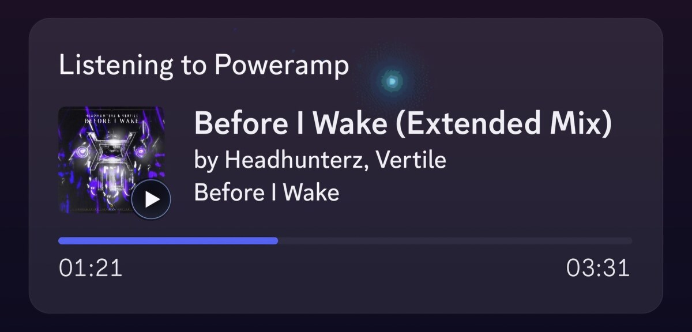
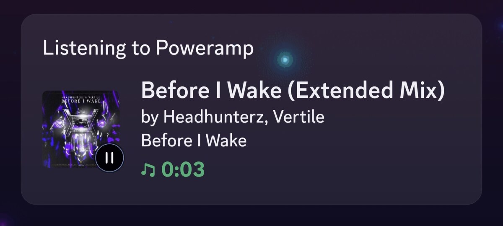
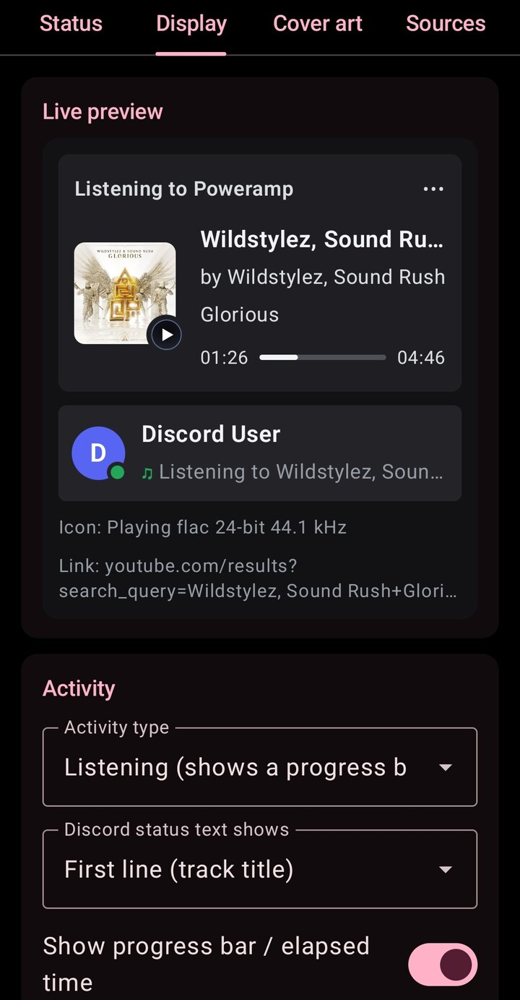
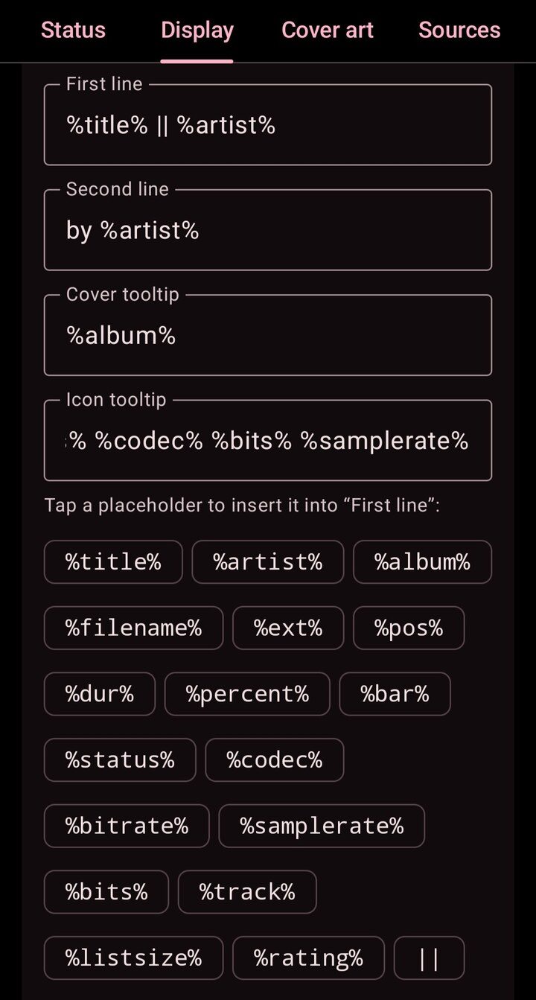
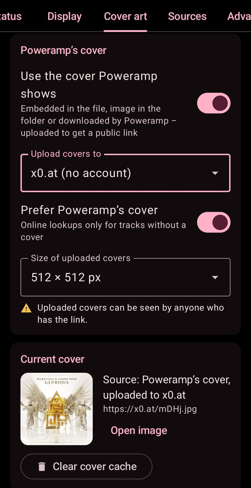
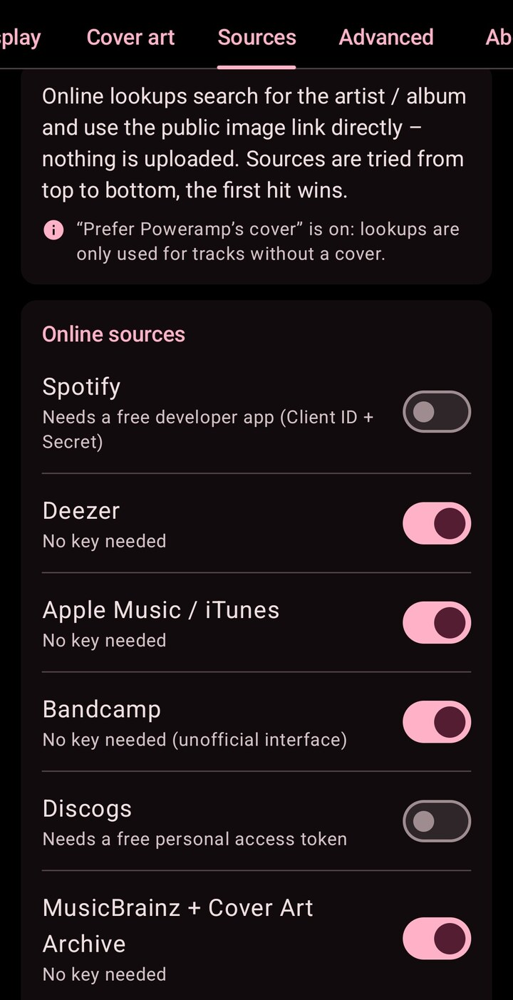

# Poweramp Discord Rich Presence 1.1.0 für Android

Zeigt den Song, den [Poweramp](https://powerampapp.com) auf deinem Handy spielt, als Discord Rich Presence an -
**„Hört Poweramp“** mit Discords eigenem Fortschrittsbalken, dem Album-Cover und einem anklickbaren Songtitel.
Funktioniert mit Poweramp **Stable und Beta** und spricht mit der **offiziellen Discord-App** auf demselben Handy:
kein Login, kein Token, kein Self-Bot. Auf Deutsch, Englisch, Russisch und Ukrainisch, mit Einrichtungs-Checkliste,
Live-Vorschau und Update-Check.

Das Android-Gegenstück zum [AIMP-Discord-Rich-Presence-Plugin](https://github.com/RainBowFl4sh/AIMP-Discord-RP-v4-v6--Win32_64Bit--Linux) -
dieselben Funktionen, dieselben Cover-Quellen, dieselben Einstellungen, soweit sie auf einem Handy Sinn ergeben.

**English:** [README.md](README.md) · Änderungen: [Deutsch](CHANGELOG.de.md) · [English](CHANGELOG.md)

| Datei (auf der Seite [Releases](https://github.com/RainBowFl4sh/Poweramp-Discord-RP/releases)) | |
|---|---|
| `PowerampDiscordRP-v1.1.0.apk` | die App - Android 8.0 oder neuer, jede CPU |
| `PowerampDiscordRP-v1.1.0.apk.sha256` | SHA-256-Prüfsumme der APK |

Autor: **Fl4sh**

## Vorschau

Das zeigt dein Discord-Profil, während ein Song läuft - Discords eigener Fortschrittsbalken, das Cover mit dem
kleinen Play-/Pause-Symbol und der anklickbare Songtitel:

<p align="center">
  
</p>
<p align="center">
  
</p>

In der Mitgliederliste: standardmäßig *Hört &lt;Interpret&gt;* - oder stattdessen *Hört Poweramp* (der Name der
Anwendung) bzw. der Songtitel (Tab *Anzeige*):

<p align="center">
  
</p>

### Die App

| *Anzeige*: Live-Vorschau | *Anzeige*: Texte, Platzhalter, `\|\|`-Wechsel | *Cover* | *Quellen* |
|:---:|:---:|:---:|:---:|
|  |  |  |  |

Die Screenshots zeigen die App auf Englisch; sie folgt der Sprache des Handys.

## Funktionen

- Songtitel / Interpret / Album in deinem Discord-Profil mit Discords **eigenem Fortschrittsbalken** („Hört Poweramp“)
- Funktioniert mit **Poweramp Stable und Beta**: nutzt die öffentliche Intent-API von Poweramp (Build 948 oder
  neuer), geprüft mit Build 1025 (Stable) und 1032 (Beta)
- Spricht mit der **offiziellen Discord-App** über den Rich-Presence-Dienst, den Discord für sein Social SDK
  eingebaut hat - kein Login, kein Token, kein Self-Bot. Der Dienst gehört zu Discord, die Schnittstelle, die die
  App nutzt, ist aber nicht dokumentiert (per Reverse Engineering ermittelt, siehe [Danksagung](#danksagung)) -
  Discord kann sie mit jedem Update ändern oder einschränken
- **Album-Cover**, ohne von einem Streamingdienst abzuhängen:
  - das Cover, das Poweramp anzeigt (eingebettet, Ordnerbild oder von Poweramp heruntergeladen), wird auf 512x512
    zugeschnitten, als JPEG gespeichert und zu **x0.at** (ohne Konto / Schlüssel), catbox.moe oder Imgur
    (Client-ID) hochgeladen; jeder Upload wird geprüft, und fällt das gewählte Ziel aus, springt x0.at oder
    catbox.moe ein. Ein Bild wird nur einmal hochgeladen, egal wie viele Titel es zeigen
  - Online-Suche ohne Upload: **Spotify** (kostenlose Entwickler-App), **Deezer**, **Apple Music / iTunes**,
    **Bandcamp**, **Discogs** (kostenloser Token), **MusicBrainz + Cover Art Archive**
  - Cover werden auf dem Handy zwischengespeichert; hochgeladene Cover werden nach 3 Tagen erneut geprüft und neu
    hochgeladen, wenn der Dienst sie gelöscht hat; Cover, die Discord nicht laden kann („?“), werden repariert
- App-Logo (das Bild `poweramp` der Discord-Anwendung), wenn kein Cover gefunden wird
- Anklickbarer Songtitel: öffnet eine YouTube-Suche nach Interpret + Titel (eigener Link möglich)
- Bei Pause: „Pausiert“ anzeigen, ausblenden (dann sind deine anderen Aktivitäten zu sehen) oder nach N Minuten
  ausblenden
- Internetradio / Streams ausblenden, Dateien ausblenden, deren Pfad einen bestimmten Text enthält (z. B. Podcasts,
  Hörbücher)
- Textvorlagen mit Platzhaltern (siehe [Platzhalter](#platzhalter)), **wechselnde Texte** (`%artist% || %title%`,
  siehe [Wechselnde Texte](#wechselnde-texte)), Play-/Pause-Symbol, Text-Fortschrittsbalken
- **Live-Vorschau** der Discord-Karte, während du die Texte bearbeitest
- **Status-Seite** mit Einrichtungs-Checkliste, Verbindungsstatus, *Test-Presence senden* und *Neu verbinden*
- **Update-Check** über die GitHub-Releases (abschaltbar)
- Deutsch, Englisch, Russisch und Ukrainisch - folgt der Sprache des Handys
- Sparsam: läuft als kleiner Vordergrunddienst (mit Benachrichtigung) **nur, während Poweramp spielt**, und beendet
  sich selbst eine Minute, nachdem nichts mehr angezeigt wird

## Voraussetzungen

- **Android 8.0** (API 26) oder neuer
- **Poweramp** (v3) **Build 948 oder neuer** - Stable oder Beta
- Die **Discord-App** für Android in einer **aktuellen Version** (2026, mit dem Rich-Presence-Dienst des Social SDK),
  installiert und **auf demselben Handy angemeldet**. Ältere Discord-Versionen haben diesen Dienst nicht - der Tab
  *Status* zeigt es an
- In Discord: *Einstellungen -> Aktivitätsprivatsphäre* -> das Teilen deiner Aktivität muss an sein
- Internet für die Cover (die Presence selbst läuft über die Discord-App)

## Installation und Einrichtung

1. `PowerampDiscordRP-vX.Y.Z.apk` von der Seite [Releases](https://github.com/RainBowFl4sh/Poweramp-Discord-RP/releases)
   herunterladen und installieren (Android fragt, ob dein Browser / Dateimanager Apps installieren darf)
2. **Die App einmal öffnen** (und nach *Beenden erzwingen* erneut). Android stellt Poweramps Broadcasts keiner App
   zu, die noch nie geöffnet wurde oder die zwangsweise beendet und seitdem nicht geöffnet wurde
3. **Benachrichtigungen erlauben** - die App fragt beim ersten Start danach (Android 13+). Solange eine Presence
   angezeigt wird, läuft die App als Vordergrunddienst, und dafür verlangt Android eine Benachrichtigung
4. **Akku-Optimierung** für die App **abschalten** (Schaltfläche im Tab *Status*). Sonst lässt Android die App nicht
   im Hintergrund starten, wenn Poweramp zu spielen beginnt. Manche Handys (Xiaomi, Huawei, Samsung, OnePlus, ...)
   haben zusätzlich einen Schalter *Autostart* / *Hintergrundaktivität* - den auch erlauben
5. In **Discord**: prüfen, dass du angemeldet bist, und das Teilen der Aktivität einschalten
   (*Einstellungen -> Aktivitätsprivatsphäre*)
6. In **Poweramp**: **einmal Pause und Play** drücken. Poweramp merkt sich, welche Apps seine Broadcasts empfangen,
   und aktualisiert diese Liste nur, wenn die Wiedergabe (neu) startet
7. Im Tab *Status* sollte jetzt alles grün sein. Spiel einen Song - dein Discord-Profil zeigt „Hört Poweramp“ (die
   Mitgliederliste standardmäßig den Interpreten). *Test-Presence senden* zeigt 15 Sekunden lang eine
   Test-Presence, auch wenn nichts läuft

**Aktualisieren:** die neue APK einfach über die alte installieren - deine Einstellungen bleiben erhalten. Der Tab
*Über* meldet, wenn es eine neue Version gibt.

**Neues Handy:** Die Einstellungen sind nicht Teil der Android-Sicherung oder der Übertragung von Gerät zu Gerät
(sie können deine Schlüssel für Spotify / Discogs / Imgur enthalten). Übertrage sie mit *Erweitert ->
Einstellungsdatei -> Exportieren* auf dem alten und *Importieren* auf dem neuen Handy.

## So funktioniert es

```
 Poweramp (Stable oder Beta)
    |  Broadcasts TRACK_CHANGED_EXPLICIT / STATUS_CHANGED_EXPLICIT: Titel, Play / Pause, Position
    v
 Poweramp Discord RP  <-- Cover von Poweramps eigenem Provider (content://com.maxmpz.audioplayer.aa)
    |                 --> Cover-Upload (x0.at / catbox.moe / Imgur) oder Suche (Deezer, iTunes, ...) = öffentliche URL
    |  SET_ACTIVITY: Texte, Zeitstempel, Cover-URL (dasselbe JSON wie Discords Desktop-RPC)
    v
 Discord-App  (gebundener Dienst com.discord.socialsdk.rpc.IDiscordRpcService)
    |
    v
 dein Profil: „Hört Poweramp“ - die Mitgliederliste: „Hört <Interpret>“ (standardmäßig)
```

- **Poweramp-Seite:** Poweramp schickt seine expliziten Broadcasts an jede App, die einen passenden Empfänger
  anmeldet. So kann Android diese App wecken, wenn du auf Play drückst. Poweramps eigener Cover-Provider liefert
  dasselbe Bild, das Poweramp anzeigt - eingebettet, Ordnerbild oder von Poweramp heruntergeladen.
- **Discord-Seite:** Die Discord-App enthält einen Rich-Presence-Dienst für Spiele, die Discords Social SDK nutzen.
  Die App verbindet sich damit über die ID der Discord-Anwendung und schickt die Aktivität als JSON - genau das,
  was Desktop-Programme an Discord auf dem PC schicken. Discord zeigt den Namen der Anwendung („Poweramp“) und ihre
  Bilder. Der Dienst ist offiziell, aber Discord dokumentiert diese Schnittstelle nicht für andere Apps: Die App
  nutzt eine per Reverse Engineering ermittelte Beschreibung (siehe [Danksagung](#danksagung)), ein Discord-Update
  kann sie also ändern oder schließen.
- **Cover:** Discord zeigt nur Bilder mit öffentlicher URL. Deshalb wird das Cover einmal hochgeladen oder online
  gefunden und dann zwischengespeichert. Discord lädt das Bild selbst - alle sehen dieselbe Presence.
- **Akku:** Der Vordergrunddienst läuft nur, solange etwas angezeigt wird. Änderungen werden zusammengefasst
  (höchstens eine alle 2 Sekunden), und der Fortschrittsbalken kostet nichts - Discord bewegt ihn selbst.

## Einstellungen

**Status** - die Einrichtungs-Checkliste (Poweramp installiert und neu genug, Discord-App mit Rich-Presence-Dienst,
Benachrichtigungen, Akku-Optimierung, ID der Discord-Anwendung), der Verbindungsstatus, *Test-Presence senden*
(15 s, auch wenn nichts läuft) und *Neu verbinden*

**Anzeige** - Aktivitätstyp (*Hört* mit Fortschrittsbalken / *Spielt*), was dein Status in der Mitgliederliste
zeigt (Name der Anwendung, Interpret - der Standard - oder Songtitel), die Textvorlagen für beide Zeilen und die
Tooltips von Cover und kleinem Symbol, das Wechselintervall für Texte mit `||`, Play-/Pause-Symbol,
Fortschrittsbalken / verstrichene Zeit, anklickbarer Songtitel (YouTube-Suche oder eigener Link), Verhalten bei Pause
(„Pausiert“ anzeigen / ausblenden / nach N Minuten ausblenden), Streams und Pfade ausblenden - und die
**Live-Vorschau** der Discord-Karte, die sich beim Tippen aktualisiert. Ist die Presence ausgeblendet (pausiert,
gefiltert, ...), sagt die Vorschau, warum

**Cover** - Cover an / aus, Poweramps Cover + Upload-Ziel (x0.at, catbox.moe oder Imgur mit Client-ID), das aktuelle
Cover mit seiner Quelle und der Cover-Cache

**Quellen** - Online-Suche bei Spotify, Deezer, Apple Music / iTunes, Bandcamp, Discogs und MusicBrainz + Cover Art
Archive

**Erweitert** - eigene Discord-Anwendung (Application ID), der Kompatibilitätsschalter *Zeitstempel in Sekunden*,
das aktuelle Log, Export / Import aller Einstellungen und Zurücksetzen auf die Standardwerte

**Über** - Version, Autor mit GitHub-Bild, Links (GitHub, Releases, Problem melden), Update-Check (bei jedem
Start, täglich, wöchentlich, monatlich oder aus; *Jetzt suchen*) und der Changelog

**App-Einstellungen** (Drei-Punkte-Menü oben rechts) - Design *Wie im System* / *Hell* / *Dunkel*, **AMOLED-Schwarz**
(rein schwarzer Hintergrund im dunklen Modus) und dynamische **Material-You**-Farben ab Android 12 (aus = die eigenen,
Discord-ähnlichen Farben der App). Bleiben getrennt von den Presence-Einstellungen auf dem Handy (nicht Teil von
Export / Import)

### Platzhalter

Verwendbar in beiden Zeilen, den Tooltips und deinem eigenen Titel-Link (Groß-/Kleinschreibung egal):

| Platzhalter | Bedeutung |
|---|---|
| `%title%` `%artist%` `%album%` | die Tags des Titels |
| `%filename%` `%ext%` | Dateiname ohne Ordner und Endung, die Endung |
| `%pos%` `%dur%` `%percent%` | Position, Dauer (m:ss), Position in Prozent |
| `%bar%` | Text-Fortschrittsbalken `▰▰▰▱▱▱` (standardmäßig 12 Zeichen) |
| `%status%` | „Wiedergabe“ / „Pausiert“ in der Sprache der App |
| `%codec%` `%bitrate%` `%samplerate%` `%bits%` | Audioformat (wenn Poweramp es meldet) |
| `%track%` `%listsize%` | Position in Poweramps aktueller Liste (ab 1), Anzahl der Titel darin |
| `%rating%` | die Bewertung des Titels in Poweramp |

Texte mit `%pos%`, `%bar%` oder `%percent%` werden regelmäßig aktualisiert (standardmäßig alle 15 Sekunden).
Discord nimmt höchstens **128 Bytes (UTF-8)** pro Textfeld an - etwa 128 lateinische, aber nur 64 kyrillische
Buchstaben oder 42 chinesische / japanische Zeichen. Längere Texte werden mit „…“ gekürzt; ein einzelnes Zeichen
wird auf Discords Minimum von 2 aufgefüllt.

#### Wechselnde Texte

Mit `||` zwischen Alternativen wechseln sich Texte ab: Mit `%artist% || %title%` als zweiter Zeile zeigt Discord
10 Sekunden lang den Interpreten, dann den Titel, dann wieder den Interpreten und so weiter. Im Tab *Anzeige* gibt es
einen `||`-Chip neben den Platzhaltern und das **Wechselintervall** (5-60 Sekunden, standardmäßig 10); die
Live-Vorschau wechselt mit.

- Funktioniert in beiden Zeilen und beiden Tooltips. Jede Alternative ist ein eigener Text (128 Bytes); ein einzelnes
  `|` ist normaler Text
- Alle Texte wechseln im selben Moment (in jedem Wechselintervall). Texte mit gleich vielen Alternativen bleiben
  Paare: Mit `%title% || %album%` als erster und `%artist% || %codec%` als zweiter Zeile kommt der Titel immer mit dem
  Interpreten und das Album mit dem Codec
- Jeder neue Song beginnt mit der ersten Alternative; Pause, Fortsetzen und Spulen fangen nicht von vorn an. Solange
  die Presence ausgeblendet ist, wechselt nichts
- Alternativen, die leer bleiben, werden übersprungen: `%album% || %title%` zeigt bei einem Song ohne Album-Tag nur
  den Titel
- Der Link des anklickbaren Titels wechselt nicht: Seine Platzhalter liefern immer die Werte des Songs selbst (`||`
  wird dort nicht aufgeteilt)
- Discord nimmt höchstens **5 Aktualisierungen pro 20 Sekunden** an, daher mindestens 5 Sekunden. Jeder Wechsel
  aktualisiert auch `%pos%`, `%bar%` und `%percent%`; deren regelmäßige Aktualisierung entfällt, wenn binnen
  5 Sekunden ein Wechsel folgt - so bleiben beide zusammen im Limit

## Cover-Quellen

| Quelle | Schlüssel nötig | Hinweise |
|---|---|---|
| Poweramps Cover -> x0.at | nein | Standard; öffentlicher Link; bleibt Tage (große Dateien) bis Monate (kleine Dateien) - abgelaufene Cover werden neu hochgeladen |
| Poweramps Cover -> catbox.moe | nein | öffentlicher Link (catbox.moe hat Uploads ohne Konto zeitweise abgelehnt - dann springt x0.at ein) |
| Poweramps Cover -> Imgur | Client-ID | api.imgur.com/oauth2/addclient |
| Spotify | Client ID + Secret | developer.spotify.com/dashboard |
| Deezer | nein | |
| Apple Music / iTunes | nein | |
| Bandcamp | nein | inoffizielle Schnittstelle, kann sich ändern |
| Discogs | persönlicher Token | discogs.com/settings/developers |
| MusicBrainz / Cover Art Archive | nein | |

Das Cover, das Poweramp anzeigt, kommt zuerst (Tab *Cover*); die Online-Quellen werden von oben nach unten
probiert, und der erste plausible Treffer zählt. Wird nichts gefunden, erscheint das App-Logo (Bild `poweramp`).

## Fehlerbehebung

### Discord zeigt nichts an

Öffne die App: Der Tab *Status* prüft das meiste davon und sagt, was fehlt.

- **Discord-App zu alt:** Den Rich-Presence-Dienst gibt es nur in aktuellen Discord-Versionen (2026, Social SDK).
  Aktualisiere Discord im Play Store
- **Nicht angemeldet:** Discord einmal öffnen und auf diesem Handy anmelden
- **Teilen der Aktivität ist aus:** Discord -> *Einstellungen -> Aktivitätsprivatsphäre* -> Aktivität teilen
- **Akku-Optimierung:** Erscheint die Presence nur, solange die App offen ist, blockiert Android den Start im
  Hintergrund. Akku-Optimierung für die App abschalten (und auf Handys, die das haben, *Autostart* erlauben)
- **Funktioniert nach *Beenden erzwingen* oder einem Handy-Cleaner nicht mehr:** Android stellt der App dann keine
  Broadcasts mehr zu, bis du sie wieder öffnest - einmal öffnen. Manche Handys (z. B. Xiaomi / MIUI,
  Oppo / ColorOS) beenden Apps zwangsweise, wenn man sie aus den letzten Apps wischt oder eine „Boost“-Funktion sie
  aufräumt: die App in den letzten Apps sperren (Schloss) und *Autostart* erlauben
- **Poweramp kennt die App noch nicht:** in Poweramp einmal Pause und Play drücken (nach dem Installieren oder
  Aktualisieren dieser App)
- **Keine ID der Discord-Anwendung:** Die APK wurde ohne gebaut (*Status* zeigt das an). Trag im Tab *Erweitert*
  eine eigene ein - siehe [Discord-Anwendung](#discord-anwendung-für-alle-die-die-apk-bauen)
- **Ungültige Application ID:** Discord trennt die Verbindung (Code 4000); prüfe die ID im Tab *Erweitert*. Bis du
  sie änderst oder Discord sie annimmt (*Neu verbinden* / *Test-Presence senden*), startet Poweramp die App nicht
  mehr im Hintergrund
- **Discord lehnt die Presence ab:** Das Log zeigt *Discord error ...* mit Discords Begründung, und es wird nichts
  angezeigt, bis Discord eine Änderung annimmt - prüfe z. B. einen eigenen Titel-Link im Tab *Anzeige*
- **Verbunden, aber keine Presence / falscher Fortschrittsbalken:** *Erweitert -> Zeitstempel in Sekunden*
  einschalten (manche Discord-Versionen erwarten Sekunden statt Millisekunden)
- **Eigene Anwendung:** Das *Social SDK* für die Anwendung im Developer Portal (*Getting Started*) freizuschalten,
  kann helfen - ob das nötig ist, ist nicht bestätigt
- Immer noch nichts: Das Log im Tab *Erweitert* zeigt, was passiert ist (Verbindung, Antworten von Discord, Fehler)

### Kein Cover / nur das Logo

- **Upload-Dienst ausgefallen:** im Tab *Cover* ein anderes Upload-Ziel wählen. Ein ausgefallener Dienst wird
  30 Minuten übersprungen und ein anderer springt automatisch ein; das Log zeigt den Fehler
- **Upload abgeschaltet:** Dann werden nur die Online-Quellen genutzt - Titel, die sie nicht kennen, zeigen das Logo
- Die **Online-Suche** sucht nach Interpret + Album / Titel, bei seltenen Veröffentlichungen kann das Cover fehlen
  oder falsch sein
- Discord zeigt ein **„?“** statt des Covers: Die App prüft Discords Kopie ein paar Sekunden nach dem Senden und
  schickt das Cover erneut bzw. sucht es neu; hilft nichts, erscheint das Logo
- Kein Internet im Hintergrund (Datensparmodus): Hintergrunddaten für die App erlauben

### Die Benachrichtigung

Android verlangt eine sichtbare Benachrichtigung, solange eine App einen Vordergrunddienst ausführt. Sie ist nur da,
während Poweramp spielt, und verschwindet eine Minute, nachdem nichts mehr angezeigt wird. Du kannst sie in den
Android-Benachrichtigungseinstellungen der App ausblenden - die Presence funktioniert weiter.

Mit ihrer Schaltfläche *Beenden* verschwindet die Presence, bis Poweramp wieder zu spielen beginnt (oder du in der App
*Test-Presence senden* / *Neu verbinden* tippst - die App weist dann darauf hin); die App in
Androids Liste der aktiven Apps zu beenden (Android 14+), wirkt genauso. Wird Poweramp während der Wiedergabe
zwangsweise beendet (und kann nicht mehr melden, dass es aufgehört hat), endet die Presence eine Weile nach dem
Zeitpunkt, an dem der Song zu Ende gewesen wäre. Lässt Android die App nicht im Hintergrund starten, meldet das eine Benachrichtigung (höchstens einmal
am Tag) - siehe *Akku-Optimierung* oben.

## Datenschutz und Netzwerk

- Kein Discord-Login, kein Token: Die App übergibt die Aktivität an die Discord-App auf deinem Handy, die sie wie
  jede andere Rich Presence anzeigt. Die Discord-App teilt ihr deinen Discord-Namen und dein Profilbild mit; die App
  zeigt beides in der Vorschau (den Namen auch im Tab *Status*) und schreibt den Namen ins Log („Connected to
  Discord as ...“). Beides bleibt auf dem Handy
- Netzwerkzugriffe - das sind alle:
  - für Cover, die hochgeladen werden: das gewählte Upload-Ziel (x0.at, catbox.moe oder api.imgur.com) und, **wenn
    es ausfällt, x0.at oder catbox.moe** - automatisch. Wer das nicht möchte, schaltet den Upload im Tab *Cover* ab
  - die im Tab *Quellen* eingeschalteten Suchdienste
  - die Server der Cover-Bilder selbst (das Upload-Ziel oder z. B. die Bildserver von Spotify, Deezer oder Apple):
    Die App lädt ein Cover, um zu prüfen, ob ein Upload geklappt hat bzw. noch da ist, und um es in der Vorschau und
    im Tab *Cover* zu zeigen
  - Discords Bildserver: `media.discordapp.net` (ein paar Sekunden nach einem neuen Cover: Kann Discord es laden?)
    und `cdn.discordapp.com` (dein Profilbild und die Bilder der Application in der Vorschau)
  - `discord.com/api` einmal pro Verbindung: der öffentliche Name und die Art-Asset-Liste der Discord-Application
    (ohne Login). Die Discord-App zeigt das kleine Play-/Pause-Bild und das Logo nur als Bild-URL, nicht über den
    Asset-Namen
  - `api.github.com` für den Update-Check (im Tab *Über* abschaltbar)
  - `avatars.githubusercontent.com`: das GitHub-Bild des Autors, nur solange der Tab *Über* angezeigt wird (im
    Speicher gehalten)
- **Hochgeladene Cover sind öffentlich**: Jeder mit dem Link kann sie öffnen. Der Upload lässt sich im Tab *Cover*
  abschalten
- Schlüssel für Spotify / Discogs / Imgur bleiben auf dem Handy und gehen nur an den jeweiligen Dienst. Sie sind
  nicht Teil der Android-Sicherung. Ein Einstellungs-Export enthält sie (die App weist darauf hin) - teile diese
  Datei nicht öffentlich
- Keine Statistik, keine Werbung, kein Tracking

## Discord-Anwendung (für alle, die die APK bauen)

**Normale Nutzer brauchen das nicht** - die veröffentlichte APK enthält bereits eine Application ID (der
Release-Workflow veröffentlicht keine APK ohne gültige ID).

Eine Discord-Anwendung legt den Namen fest, den Discord zeigt („Hört **Poweramp**“), und die Bilder (Logo, Play-/
Pause-Symbol). Wer die APK baut oder veröffentlicht, legt sie **einmal** an:

1. [Discord Developer Portal](https://discord.com/developers/applications) -> *New Application* -> Name **Poweramp**
2. Die **Application ID** kopieren (*General Information*)
3. In `gradle.properties` eintragen (`discordApplicationId=...`), `-PdiscordApplicationId=...` übergeben oder für
   GitHub Actions als Secret `DISCORD_APPLICATION_ID` speichern
4. *Rich Presence -> Art Assets*: die Bilder aus [`docs/assets/`](docs/assets) unter genau diesen Namen hochladen:
   `poweramp` (Logo), `play`, `pause`

Schritt für Schritt mit allen Details: [docs/discord-application.de.md](docs/discord-application.de.md)
([English](docs/discord-application.md)). Wer einen eigenen Namen oder eigene Bilder möchte, kann im Tab *Erweitert*
eine eigene Anwendung eintragen.

## Selbst bauen

Nötig sind **JDK 17** oder neuer und das **Android SDK** mit Plattform 36 (`ANDROID_HOME` oder `sdk.dir` in
`local.properties`).

```
./gradlew :core:test :app:testDebugUnitTest :app:assembleDebug -PdiscordApplicationId=<deine Application ID>
```

Ergebnis: `app/build/outputs/apk/debug/app-debug.apk`. Die Application ID der Discord-Anwendung „Poweramp“ steht in
`gradle.properties`; `-PdiscordApplicationId=` überschreibt sie. Ohne Application ID lässt sich die App ebenfalls
bauen; sie fragt dann im Tab *Erweitert* nach einer eigenen Anwendung.

Ein Debug-Build ist deutlich langsamer als ein Release (kein R8, debuggable, kein Baseline-Profil). Wie die App
wirklich läuft, zeigt die optimierte **Staging**-APK: `./gradlew :app:assembleStaging` - wie ein Release, aber mit dem
Debug-Schlüssel signiert, sodass sie sich über einen Debug-Build vom selben Rechner installieren lässt. Release-Builds
(`:app:assembleRelease`) werden mit R8 verkleinert (`app/proguard-rules.pro`) und bringen das Baseline-Profil
`app/src/main/baseline-prof.txt` mit.

Das Projekt hat zwei Module:

- `core/` - reines Kotlin: Presence-Texte und Platzhalter, Discord-RPC-Frames, die Presence-Engine (Verbindung,
  Pausen-Verhalten, Cover-Reparatur), Cover-Suche und Update-Check. Ohne Android unit-getestet
- `app/` - der Android-Teil: Poweramp-Empfänger, die Verbindung zur Discord-App, der Vordergrunddienst und die
  Einstellungsoberfläche (Jetpack Compose)

**Release-Build:** `./gradlew :app:assembleRelease` - signiert, wenn diese Umgebungsvariablen gesetzt sind (siehe
`app/build.gradle.kts`), sonst `app-release-unsigned.apk`:

| Variable | |
|---|---|
| `SIGNING_KEYSTORE_PATH` | Pfad der Keystore-Datei |
| `SIGNING_KEYSTORE_PASSWORD` | Keystore-Passwort |
| `SIGNING_KEY_ALIAS` | Alias des Schlüssels |
| `SIGNING_KEY_PASSWORD` | Passwort des Schlüssels - bei einem PKCS12-Keystore (Standard von keytool) das Keystore-Passwort |

**GitHub Actions** (`.github/workflows/build.yml`) führt bei jedem Push und Pull Request die Tests aus und baut
beide APKs; sie hängen am jeweiligen Lauf (*Actions -> Build*). Nur Builds von `v*`-Tags werden mit dem
Release-Schlüssel signiert - bei Branches und Pull Requests ist die Release-APK `app-release-unsigned.apk`. Schlagen
Tests fehl, hängen stattdessen die Testberichte daran.

## Ein Release veröffentlichen

> **Hinweis für den Maintainer:** Das GitHub-Repository ist zurzeit **privat**. Solange es nicht öffentlich ist,
> liefern die Links auf *Releases* und Issues in dieser README und in der App sowie der Update-Check der App (eine
> anonyme Anfrage an `api.github.com`) *404 Not Found* - die App zeigt dann „Es wurde noch keine Version
> veröffentlicht.“ und betrachtet die Prüfung bis zur nächsten planmäßigen als erledigt. Releases eines privaten
> Repositorys sind ebenfalls privat: Um nur die Releases zu veröffentlichen, müssten sie aus einem eigenen öffentlichen
> Repository kommen, und `GITHUB_REPO` in `app/build.gradle.kts` (sowie die Links in dieser README) müssten es nennen.

1. Einmalig: die [Discord-Anwendung](docs/discord-application.de.md) anlegen und einen Signaturschlüssel erzeugen,
   z. B.

   ```
   keytool -genkeypair -v -keystore release.keystore -alias poweramp-discord-rp -keyalg RSA -keysize 4096 -validity 10000
   ```

   Mit JDK 9 oder neuer entsteht ein PKCS12-Keystore. Er hat nur ein Passwort: keytool fragt nicht nach einem
   eigenen Schlüssel-Passwort - das Passwort des Schlüssels ist das Keystore-Passwort.
   **Keystore und Passwort gut aufheben** - Android installiert ein Update nur, wenn es mit demselben Schlüssel
   signiert ist.
2. Einmalig: die Repository-Secrets anlegen (*Settings -> Secrets and variables -> Actions*):
   `DISCORD_APPLICATION_ID`, `SIGNING_KEYSTORE_BASE64` (Ausgabe von `base64 -w0 release.keystore`),
   `SIGNING_KEYSTORE_PASSWORD` und `SIGNING_KEY_ALIAS`. `SIGNING_KEY_PASSWORD` ist nur für einen Keystore mit
   eigenem Schlüssel-Passwort nötig (ein älterer JKS-Keystore); ohne dieses Secret wird das Keystore-Passwort
   verwendet
3. `versionName` und `versionCode` in `app/build.gradle.kts` erhöhen und einen Abschnitt für die neue Version
   (Überschrift `## X.Y.Z`) in `CHANGELOG.md`, `CHANGELOG.de.md` und die Changelogs der App
   (`app/src/main/res/raw*/changelog.md`) eintragen
4. Tag setzen und pushen: `git tag v1.0.0 && git push origin v1.0.0`

Der Workflow prüft, ob der Tag zu `versionName` passt, ob jeder Changelog den Abschnitt der Version hat und ob eine
ID der Discord-Anwendung (17 bis 20 Ziffern) gesetzt ist - sonst bricht der Build ab, bevor etwas veröffentlicht
wird. Dann führt er die Tests aus, baut und signiert die APK und legt das GitHub-Release mit
`PowerampDiscordRP-v1.0.0.apk`, der `.sha256`-Datei und dem Abschnitt der Version aus `CHANGELOG.md` als Text an.
Tags mit `-` (z. B. `v1.1.0-beta1`) werden zu Vorab-Releases. Der Update-Check der App liest
`https://api.github.com/repos/RainBowFl4sh/Poweramp-Discord-RP/releases/latest` (Vorab-Releases werden nicht
angeboten): Die Version stammt aus dem Tag oder Titel, der Download ist die erste angehängte `.apk`.

## Änderungen

Alle Änderungen stehen in [CHANGELOG.de.md](CHANGELOG.de.md) (auch auf [English](CHANGELOG.md)) und im Tab *Über*
der App.

**1.1.0** - Neues App-Symbol im Poweramp-Stil, wechselnde Texte mit `||` (z. B. `%artist% || %title%`),
App-Einstellungen (Design wie im System / hell / dunkel, AMOLED-Schwarz, Material-You-Farben), das GitHub-Bild des
Autors im Tab *Über* und eine deutlich flüssigere App (mit R8 optimierte Release-Version mit Baseline-Profil).

**1.0.0** - Erste Version: Poweramp (Stable und Beta) als Discord Rich Presence über die offizielle Discord-App, mit
Covern, anklickbarem Titel, Live-Vorschau, Einrichtungs-Checkliste und Update-Check - auf Deutsch, Englisch,
Russisch und Ukrainisch.

## Sprachen

Deutsch, English, Русский, Українська - die App folgt der Sprache des Handys.

> **Hinweis:** Die **russische** und die **ukrainische** Übersetzung wurden mit Hilfe von KI erstellt. Sie können
> Fehler enthalten oder stellenweise unnatürlich klingen - Korrekturen von Muttersprachlern sind sehr willkommen
> (Issue oder Pull Request).

## Danksagung

- Basiert auf dem [AIMP-Discord-Rich-Presence-Plugin](https://github.com/RainBowFl4sh/AIMP-Discord-RP-v4-v6--Win32_64Bit--Linux)
  von Fl4sh - Presence-Logik, Cover-Quellen und Einstellungen sind von dort übernommen
- Die AIDL-Schnittstelle des Rich-Presence-Dienstes der Discord-App stammt aus
  [antisocialcord-kt](https://github.com/Nightdavisao/antisocialcord-kt) von Nightdavisao (MIT-Lizenz), das sie per
  Reverse Engineering aus Discords Social SDK ermittelt hat - Discord dokumentiert sie nicht für andere Apps
- [Poweramp API](https://github.com/maxmpz/powerampapi) von Maksim Petrov - die App nutzt die dokumentierten
  Intent- und Provider-Namen; Code der API-Bibliothek ist nicht enthalten

Lizenzen und Hinweise: [THIRD_PARTY_NOTICES.md](THIRD_PARTY_NOTICES.md).

Dieses Projekt steht in keiner Verbindung zu Poweramp / Max MP oder Discord und wird von ihnen nicht unterstützt.
„Poweramp“ und „Discord“ sind Marken ihrer jeweiligen Inhaber. Das App-Symbol und die Bilder in `docs/assets/` sind
eigene Zeichnungen im Stil des runden Poweramp-Symbols; das Logo (eine Sprechblase mit Equalizer-Balken, auch
`docs/assets/poweramp.png`) ist nicht das Logo von Poweramp.
