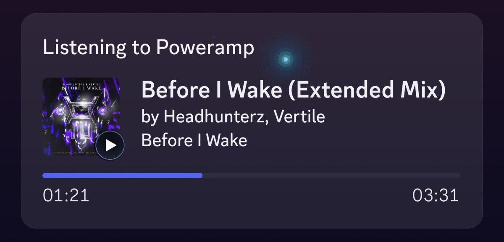
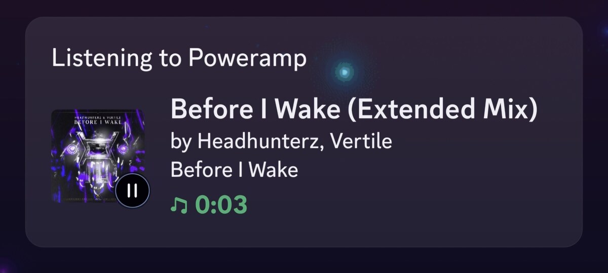
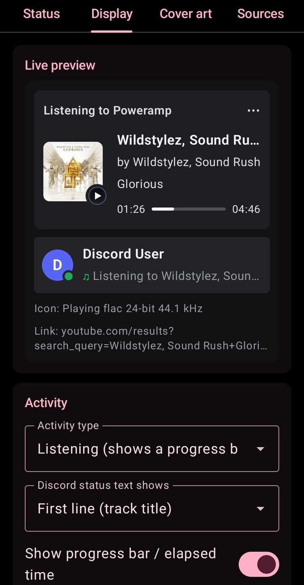
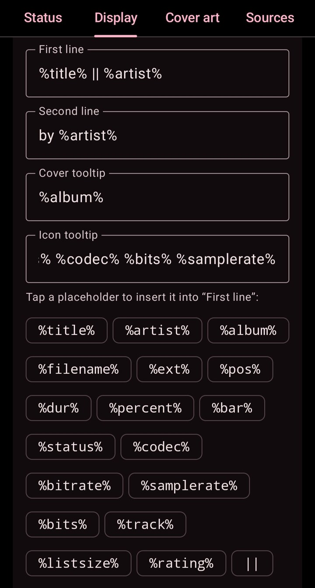
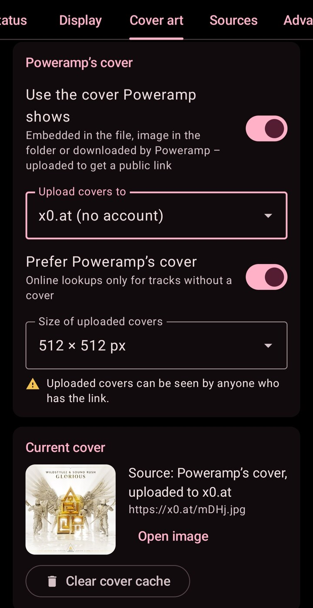
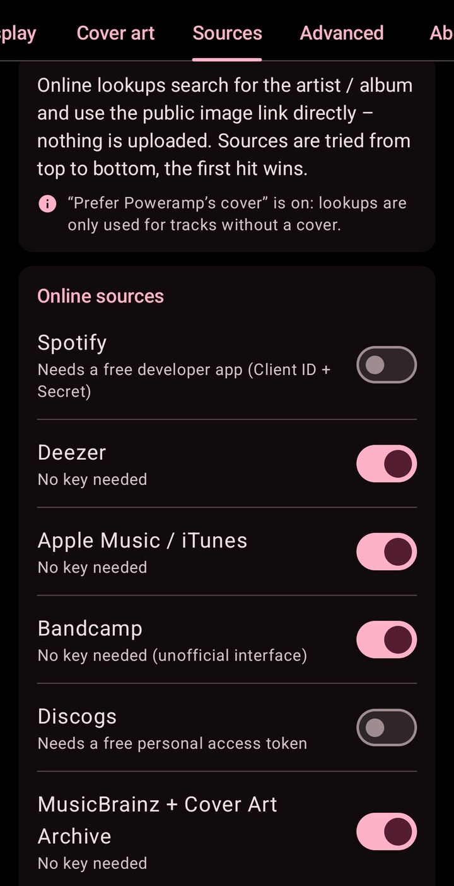

# Poweramp Discord Rich Presence 1.2.1 for Android

Shows the song [Poweramp](https://powerampapp.com) is playing on your phone as Discord Rich Presence -
**"Listening to Poweramp"** with Discord's own progress bar, the album cover and a clickable song title. It works
with Poweramp **stable and beta** and talks to the **official Discord app** on the same phone: no login, no token,
no self-bot. In 30 languages, with a setup checklist, live preview and update check - and,
if you like, your own Discord name and picture in the preview (optional account link).

The Android sibling of the [AIMP Discord Rich Presence plugin](https://github.com/RainBowFl4sh/AIMP-Discord-RP-v4-v6--Win32_64Bit--Linux) -
same features, same cover sources, same settings where they make sense on a phone.

**Deutsch:** [README.de.md](README.de.md) · Changelog: [English](CHANGELOG.md) · [Deutsch](CHANGELOG.de.md)

| File (on the [Releases](https://github.com/RainBowFl4sh/Poweramp-Discord-RP/releases) page) | |
|---|---|
| `PowerampDiscordRP-v1.2.1.apk` | the app - Android 8.0 or newer, any CPU |
| `PowerampDiscordRP-v1.2.1.apk.sha256` | SHA-256 checksum of the APK |

Author: **Fl4sh**

## Preview

What your Discord profile shows while a song plays - Discord's own progress bar, the cover with the small
play / pause icon, and the clickable song title:

<p align="center">
  
</p>
<p align="center">
  
</p>

In the member list: *Listening to &lt;artist&gt;* by default - or *Listening to Poweramp* (the application name)
or the song title instead (*Display* tab):

<p align="center">
  
</p>

### The app

| *Display*: live preview | *Display*: texts, placeholders, `\|\|` rotation | *Cover art* | *Sources* |
|:---:|:---:|:---:|:---:|
|  |  |  |  |

The app follows the phone's language (here: English) or the one chosen in its *App settings*.

## Features

- Song title / artist / album on your Discord profile with Discord's **native progress bar** ("Listening to Poweramp")
- Works with **Poweramp stable and beta**: uses Poweramp's public intent API (build 948 or newer), checked against
  build 1025 (stable) and 1032 (beta)
- Talks to the **official Discord app** through the Rich Presence service Discord built into it for its Social SDK -
  no login, no token, no self-bot. The service is Discord's own, but the interface the app uses is undocumented
  (reverse-engineered, see [Credits](#credits)) - Discord may change or restrict it with any update
- **Album cover** without depending on a streaming service:
  - the cover Poweramp shows (embedded, folder image or downloaded by Poweramp) is cropped to 512x512, saved as
    JPEG and uploaded to **x0.at** (no account / key needed), catbox.moe or Imgur (Client-ID); every upload is
    checked, and if the chosen host fails, x0.at or catbox.moe stands in. A picture is uploaded only once, however
    many tracks show it
  - online lookup without upload: **Spotify** (free developer app), **Deezer**, **Apple Music / iTunes**,
    **Bandcamp**, **Discogs** (free token), **MusicBrainz + Cover Art Archive**
  - covers are cached on the phone; uploaded covers are checked again after 3 days and uploaded again if the host
    deleted them; covers Discord cannot load ("?") are repaired
- App logo (the Discord application's `poweramp` image) as fallback if no cover is found
- Clickable song title: opens a YouTube search for artist + title (own link optional)
- Paused behaviour: show "Paused", hide (lets your other activities show) or hide after N minutes
- Hide internet radio / streams, hide files whose path contains given text (e.g. podcasts, audiobooks)
- Text templates with placeholders (see [Placeholders](#placeholders)), **rotating texts** that take turns
  (`%artist% || %title%`, see [Rotating texts](#rotating-texts)), play / pause icon, text progress bar
- **Live preview** of the Discord card while you edit the texts
- **Your Discord name and profile picture** in the live preview and on the *Status* tab: link your Discord account
  once (optional, see [Linking your Discord account](#linking-your-discord-account-optional)). Only name and picture
  are read, the access is revoked right away - the app keeps no token
- **Status page** with a setup checklist, the connection state, *Send test presence* and *Reconnect*
- **Update check** against the GitHub releases (can be switched off)
- **30 languages** (see [Languages](#languages)), following the phone's language - or pick one in *App settings*
  (on Android 13+ also under *Settings → Apps → Poweramp Discord RP → Language*). Arabic is shown right to left
- Light: runs as a small foreground service (with a notification) **only while Poweramp plays** and stops by itself
  a minute after nothing is shown any more

## Requirements

- **Android 8.0** (API 26) or newer
- **Poweramp** (v3) **build 948 or newer** - stable or beta
- The **Discord app** for Android, a **current version** (2026, with the Social SDK Rich Presence service),
  installed and **logged in on the same phone**. Older Discord versions do not have this service - the *Status*
  tab tells you
- In Discord: *Settings -> Activity Privacy* -> sharing your activity must be on
- Internet for covers (the presence itself goes through the Discord app)

## Install and setup

1. Download `PowerampDiscordRP-vX.Y.Z.apk` from the [Releases](https://github.com/RainBowFl4sh/Poweramp-Discord-RP/releases)
   page and install it (Android asks you to allow installing apps from your browser / file manager)
2. **Open the app once** (and again after a *Force stop*). Android does not deliver Poweramp's broadcasts to an app
   that has never been opened, or that was force-stopped and not opened since
3. **Allow notifications** - the app asks on its first start (Android 13+). While a presence is shown, the app runs
   as a foreground service, and Android requires a notification for that
4. **Disable battery optimization** for the app (button on the *Status* tab). Without it Android does not let the
   app start in the background when Poweramp starts playing. Some phones (Xiaomi, Huawei, Samsung, OnePlus, ...)
   have an extra *Autostart* / *Background activity* switch - allow that too
5. In **Discord**: make sure you are logged in, and turn on activity sharing (*Settings -> Activity Privacy*)
6. In **Poweramp**: press **pause and play once**. Poweramp keeps a list of the apps that receive its broadcasts
   and refreshes it only when playback (re)starts
7. The *Status* tab should now show everything in green. Play a song - your Discord profile shows "Listening to
   Poweramp" (the member list shows the artist by default). *Send test presence* shows a test presence for
   15 seconds, also when nothing plays

**Optional:** *Status -> Discord account -> Link Discord account* shows your own name and picture in the live
preview - see the next section.

**Updating:** install the new APK over the old one - your settings are kept. The *About* tab tells you when there
is a new version.

**New phone:** the settings are not part of Android's backups or device-to-device transfers (they can contain your
Spotify / Discogs / Imgur keys). Move them with *Advanced -> Settings file -> Export* on the old phone and *Import*
on the new one.

## Linking your Discord account (optional)

The Discord app's Rich Presence service does not tell other apps who is logged in - it reports a placeholder user.
To show **your** name and profile picture in the live preview (member list entry) and on the *Status* tab, link your
account once: *Status -> Discord account -> Link Discord account* (or tap the hint under the preview's member list
entry).

1. Discord's authorization page opens - in the Discord app, which opens discord.com links itself, or in the browser.
   It asks to let **Poweramp** (the Discord application) *access your username, avatar and banner* (scope
   `identify` - no e-mail, no servers, no messages). Tap *Authorize*
2. Discord sends you back to the app, which shows your name and picture

What happens behind the scenes: OAuth2 with PKCE as a *public client* (no client secret in the app). The app
exchanges the one-time code for an access token, reads your public profile (`users/@me`: ID, username, display name,
avatar) and **revokes the token right away**. It keeps only that profile on the phone (not in the settings file, not
in backups) - never a token. The presence itself does not use the link at all.

- **Refresh** reads the profile again (after you changed your name or picture): Discord's page opens again - tap
  *Authorize* once more (the access was revoked, so Discord asks again)
- **Unlink** deletes the profile from the phone. There is nothing to remove on Discord's side: the access was revoked
  right after the profile was read, so the app does not stay under *Settings -> Authorized Apps* (should it be listed
  there anyway, *Deauthorize* removes it)
- **Left Discord's page without an answer?** While the card waits for Discord, *Start again* opens the page with a
  fresh login (so does the hint in the live preview) and *Cancel* stops waiting
- A login waits at most 10 minutes for Discord's answer; an answer that does not belong to the login the app started
  is ignored

**For whoever owns the Discord application** (the built-in one or your own): linking needs two settings in the
[Developer Portal](https://discord.com/developers/applications), once - *OAuth2 -> Redirects* -> add
`powerampdiscordrp://auth/callback`, and *OAuth2 -> Public Client* on. See
[docs/discord-application.md](docs/discord-application.md#5-for-the-account-link-oauth2-redirect-and-public-client).

## How it works

```
 Poweramp (stable or beta)
    |  TRACK_CHANGED_EXPLICIT / STATUS_CHANGED_EXPLICIT broadcasts: track, play / pause, position
    v
 Poweramp Discord RP  <-- album art from Poweramp's own provider (content://com.maxmpz.audioplayer.aa)
    |                 --> cover upload (x0.at / catbox.moe / Imgur) or lookup (Deezer, iTunes, ...) = public URL
    |  SET_ACTIVITY: texts, timestamps, cover URL (same JSON as Discord's desktop RPC)
    v
 Discord app  (bound service com.discord.socialsdk.rpc.IDiscordRpcService)
    |
    v
 your profile: "Listening to Poweramp" - the member list: "Listening to <artist>" (by default)
```

- **Poweramp side:** Poweramp sends its explicit broadcasts to every app that declares a matching receiver. That
  is how Android can wake this app when you press play. Poweramp's own album art provider delivers the same picture
  Poweramp shows - embedded, folder image or downloaded by Poweramp.
- **Discord side:** the Discord app contains a Rich Presence service for games that use Discord's Social SDK. The
  app binds to it with the Discord application ID and sends the activity as JSON - exactly what desktop apps send
  to Discord on a PC. Discord shows the application's name ("Poweramp") and its images. The service is official,
  but Discord does not document this interface for other apps: the app uses a reverse-engineered description of it
  (see [Credits](#credits)), so a Discord update may change or close it.
- **Covers:** Discord only shows pictures with a public URL, so the cover is uploaded once or found online, then
  cached. Discord loads the picture itself - everyone sees the same presence.
- **Battery:** the foreground service runs only while something is shown. Updates are combined (at most one every
  2 seconds), and a progress bar costs nothing - Discord moves it by itself.

## Settings

**Status** - the setup checklist (Poweramp installed and new enough, Discord app with Rich Presence service,
notifications, battery optimization, Discord application ID), the connection state, *Send test presence* (15 s,
also when nothing plays) and *Reconnect*, and the linked **Discord account** (name, picture, *Refresh* / *Unlink*,
or *Link Discord account*)

**Display** - activity type (*Listening* with progress bar / *Playing*), what your status in the member list shows
(application name, artist - the default - or song title), the text templates for the two lines and the tooltips of
the cover and the small icon, the rotation interval for texts with `||`, play / pause icon, progress bar / elapsed
time, clickable song title (YouTube search or your own link), paused behaviour (show "Paused" / hide / hide after N
minutes), hiding streams and paths - and the **live preview** of the Discord card, updated while you type. When the
presence is hidden (paused, filtered, ...) the preview says why

**Cover art** - covers on / off, Poweramp's cover + upload host (x0.at, catbox.moe or Imgur with Client-ID),
the current cover with its source, and the cover cache

**Sources** - online lookup on Spotify, Deezer, Apple Music / iTunes, Bandcamp, Discogs and MusicBrainz + Cover
Art Archive

**Advanced** - own Discord application (Application ID), the *Timestamps in seconds* compatibility switch, the
recent log, export / import of all settings and reset to defaults

**About** - version, author with GitHub picture, links (GitHub, releases, report a problem), update check (at
every start, daily, weekly, monthly or off; *Check now*) and the changelog

**App settings** (three-dot menu at the top right) - **language** (*System default* or one of the 30 languages by
its own name; on Android 13+ the same setting as Android's per-app language), theme *Follow system* / *Light* / *Dark*, **AMOLED black** (pure
black backgrounds in dark mode) and **Material You** dynamic colors on Android 12+ (off = the app's own Discord-like
colors). Kept on the phone apart from the presence settings (not part of export / import)

### Placeholders

Usable in both lines, the tooltips and your own title link (case does not matter):

| Placeholder | Meaning |
|---|---|
| `%title%` `%artist%` `%album%` | the track's tags |
| `%filename%` `%ext%` | file name without folder and extension, the extension |
| `%pos%` `%dur%` `%percent%` | position, duration (m:ss), position in percent |
| `%bar%` | text progress bar `▰▰▰▱▱▱` (12 characters by default) |
| `%status%` | "Playing" / "Paused" in the app's language |
| `%codec%` `%bitrate%` `%samplerate%` `%bits%` | audio format (when Poweramp reports it) |
| `%track%` `%listsize%` | position in Poweramp's current list (from 1), number of tracks in it |
| `%rating%` | the track's rating in Poweramp |

Texts with `%pos%`, `%bar%` or `%percent%` are refreshed regularly (every 15 seconds by default). Discord takes at
most **128 bytes (UTF-8)** per text field - about 128 Latin letters, but only 64 Cyrillic letters or 42 Chinese /
Japanese characters. Longer texts are cut with "…"; a single character is padded to Discord's minimum of 2.

#### Rotating texts

Put `||` between alternatives to let them take turns: with `%artist% || %title%` as the second line Discord shows the
artist for 10 seconds, then the title, then the artist again, and so on. The *Display* tab has a `||` chip next to the
placeholders and the **Rotation interval** (5-60 seconds, 10 by default); the live preview rotates as well.

- Works in both lines and both tooltips. Each alternative is a text of its own (128 bytes); a single `|` is ordinary
  text
- All texts change at the same moments (every rotation interval). Texts with the same number of alternatives stay
  paired: with `%title% || %album%` as the first line and `%artist% || %codec%` as the second, the title always comes
  with the artist and the album with the codec
- Every new track starts with the first alternative; pausing, resuming and seeking do not restart it. Nothing rotates
  while the presence is hidden
- Alternatives that come out empty are skipped: `%album% || %title%` shows only the title for a track without an
  album tag
- The link of the clickable title does not rotate: its placeholders always give the track's own values (`||` is not
  split there)
- Discord accepts at most **5 updates per 20 seconds**, hence the minimum of 5 seconds. Every step also refreshes
  `%pos%`, `%bar%` and `%percent%`; their regular refresh is left out when a step follows within 5 seconds, so both
  together keep to the limit

## Cover sources

| Source | Key needed | Notes |
|---|---|---|
| Poweramp's cover -> x0.at | no | default; public link; kept for days (big files) to months (small files) - expired covers are uploaded again |
| Poweramp's cover -> catbox.moe | no | public link (catbox.moe has rejected uploads without an account at times - x0.at stands in) |
| Poweramp's cover -> Imgur | Client-ID | api.imgur.com/oauth2/addclient |
| Spotify | Client ID + Secret | developer.spotify.com/dashboard |
| Deezer | no | |
| Apple Music / iTunes | no | |
| Bandcamp | no | unofficial endpoint, may change |
| Discogs | personal token | discogs.com/settings/developers |
| MusicBrainz / Cover Art Archive | no | |

The cover Poweramp shows comes first (*Cover art* tab), the online sources are tried from top to bottom, and the
first plausible hit counts. If nothing is found, the app logo (the `poweramp` image) is shown.

## Troubleshooting

### Discord shows nothing

Open the app: the *Status* tab checks most of the following and says what is missing.

- **Discord app too old:** the Rich Presence service exists only in current Discord versions (2026, Social SDK).
  Update Discord from the Play Store
- **Not logged in:** open Discord once and log in on this phone
- **Activity sharing is off:** Discord -> *Settings -> Activity Privacy* -> share your activity
- **Battery optimization:** if the presence only appears while the app is open, Android blocks the start in the
  background. Disable battery optimization for the app (and allow *Autostart* on phones that have it)
- **Stopped working after *Force stop* or a phone cleaner:** Android then delivers no broadcasts to the app until
  you open it again - open it once. Some phones (e.g. Xiaomi / MIUI, Oppo / ColorOS) force-stop apps that are
  swiped away from the recent apps or cleaned up by a "boost" function: lock the app in the recent apps and allow
  *Autostart*
- **Poweramp does not know the app yet:** press pause and play once in Poweramp (after installing or updating
  this app)
- **No Discord application ID:** the APK was built without one (*Status* shows it). Enter your own on the
  *Advanced* tab - see [Discord application](#discord-application-for-whoever-builds-the-apk)
- **Invalid application ID:** Discord closes the connection (code 4000); check the ID on the *Advanced* tab. Until
  you change it or Discord accepts it (*Reconnect* / *Send test presence*), Poweramp no longer starts the app in the
  background
- **Discord rejects the presence:** the log shows *Discord error ...* with Discord's reason, and nothing is shown
  until Discord accepts an update - e.g. check an own title link on the *Display* tab
- **Connected, but no presence / wrong progress bar:** turn on *Advanced -> Timestamps in seconds* (some Discord
  versions expect seconds instead of milliseconds)
- **Own application:** enabling the *Social SDK* for the application in the Developer Portal (*Getting Started*)
  may help - not confirmed to be necessary
- Still nothing: the log on the *Advanced* tab shows what happened (connection, Discord's answers, errors)

### Linking the Discord account does not work

The *Discord account* card on the *Status* tab says what went wrong:

- **Discord shows "Invalid OAuth2 redirect_uri"** (or the card says the application does not know the app's return
  address): the Discord application lacks the redirect. Whoever owns it adds `powerampdiscordrp://auth/callback`
  under *OAuth2 -> Redirects* in the Developer Portal. With your own application (*Advanced* tab), that is you
- **"Public Client" is not switched on:** Discord wants a client secret, which the app does not have. The owner of
  the application switches on *OAuth2 -> Public Client*
- **Cancelled:** you did not allow it on Discord's page - tap *Link Discord account* again
- **Took too long / already used:** a login waits 10 minutes at most - start it again
- **Nothing happens after *Authorize*:** the browser did not hand the answer back to the app. Open the app again and
  tap *Start again* on the *Status* tab (if the Discord app is installed, it handles the page itself)
- The log on the *Advanced* tab shows each step (without codes or tokens)

### No cover / only the logo

- **Upload host down:** choose another host on the *Cover art* tab. A failing host is skipped for 30 minutes and
  another one stands in automatically; the log shows the error
- **Uploading switched off:** then only the online sources are used - tracks they do not know show the logo
- **Online lookups** match by artist + album / title, so obscure releases may have no or a wrong cover
- Discord shows a **"?"** instead of the cover: the app checks Discord's copy a few seconds after sending and sends
  the cover again / looks it up again; if nothing helps, the logo is shown
- No internet in the background (data saver): allow background data for the app

### The notification

Android requires a visible notification while an app runs a foreground service. It is only there while Poweramp
plays: opening Poweramp or a paused track does not start it - only a track that really plays does. It disappears a
minute after nothing is shown any more (stopped, hidden while paused, or after the paused timeout "hide after N
minutes"); with "show Paused" and no timeout it stays while Poweramp is paused. You can hide it in Android's notification settings
for the app - the presence keeps working.

Its *Stop* button ends the presence until Poweramp starts playing again (or you press *Send test presence* /
*Reconnect* in the app, which says so); stopping the app in Android's list of
active apps (Android 14+) does the same. If Poweramp is killed while it plays (and cannot report that it stopped),
the presence ends a while after the song would have ended. If Android does not let the app start in the
background, a notification says so (at most once a day) - see *Battery optimization* above.

## Privacy and network

- No Discord login, no token: the app hands the activity to the Discord app on your phone, which shows it like any
  other Rich Presence. The Discord app does not tell the app who you are (it reports a placeholder user, which only
  goes to the log)
- Your name and picture are shown only if you **link your Discord account** (optional): OAuth2 with the scope
  `identify` only; the access token reads your profile once and is revoked at once. The app keeps your public profile
  (ID, username, display name, avatar) on the phone - not in the settings file, not in backups - until you unlink
- Network access - this is all of it:
  - for covers that are uploaded: the upload host you chose (x0.at, catbox.moe or api.imgur.com) and, **if it
    fails, x0.at or catbox.moe** - automatically. Turn uploading off on the *Cover art* tab if you do not want that
  - the lookup services switched on on the *Sources* tab
  - the servers of the cover pictures themselves (the upload host, or e.g. Spotify's, Deezer's or Apple's image
    servers): the app loads a cover to check that an upload worked or is still there, and to show it in the preview
    and on the *Cover art* tab
  - Discord's image servers: `media.discordapp.net` (a few seconds after a new cover: can Discord load it?) and
    `cdn.discordapp.com` (the application's pictures in the preview; the linked account's avatar in the preview and
    on the *Status* tab)
  - `discord.com/api` once per connection: the public name and art asset list of the Discord application (no login).
    The Discord app shows the small play / pause image and the logo only as picture URLs, not by their asset keys
  - only when you link your Discord account: Discord's authorization page `discord.com/oauth2/authorize` (in the
    Discord app or the browser), then `discord.com/api` - `oauth2/token` (code -> token), `users/@me` (your public
    profile) and `oauth2/token/revoke` (the token is revoked at once)
  - `api.github.com` for the update check (can be switched off on the *About* tab)
  - `avatars.githubusercontent.com`: the author's GitHub picture, only while the *About* tab is shown (kept in memory)
- **Uploaded covers are public**: anyone with the link can open them. Uploading can be turned off on the *Cover art*
  tab
- Spotify / Discogs / Imgur keys stay on the phone and are only sent to their own service. They are not part of
  Android's backups. A settings export contains them (the app warns about that) - do not share that file publicly
- No analytics, no ads, no tracking

## Discord application (for whoever builds the APK)

**End users do not need this** - the released APK already contains an application ID (the release workflow does
not publish an APK without a valid one).

A Discord application defines the name Discord shows ("Listening to **Poweramp**") and the images (logo, play /
pause icon). Whoever builds or publishes the APK creates it **once**:

1. [Discord Developer Portal](https://discord.com/developers/applications) -> *New Application* -> name it **Poweramp**
2. Copy the **Application ID** (*General Information*)
3. Put it into `gradle.properties` (`discordApplicationId=...`), pass `-PdiscordApplicationId=...` or, for GitHub
   Actions, store it as the secret `DISCORD_APPLICATION_ID`
4. *Rich Presence -> Art Assets*: upload the images from [`docs/assets/`](docs/assets) under exactly these names:
   `poweramp` (logo), `play`, `pause`
5. For the optional account link: *OAuth2 -> Redirects* -> add `powerampdiscordrp://auth/callback`, and switch on
   *OAuth2 -> Public Client* (the app has no client secret)

Step by step with all details: [docs/discord-application.md](docs/discord-application.md)
([Deutsch](docs/discord-application.de.md)). Users who want their own name or images can enter their own
application on the *Advanced* tab.

## Build from source

Needs **JDK 17** or newer and the **Android SDK** with platform 36 (`ANDROID_HOME` or `sdk.dir` in
`local.properties`).

```
./gradlew :core:test :app:testDebugUnitTest :app:assembleDebug -PdiscordApplicationId=<your application ID>
```

Result: `app/build/outputs/apk/debug/app-debug.apk`. The application ID of the "Poweramp" Discord application is
set in `gradle.properties`; `-PdiscordApplicationId=` overrides it. Without an application ID the app builds as well;
it then asks for an own application on the *Advanced* tab.

A debug build is much slower than a release (no R8, debuggable, no baseline profile). To see how the app really runs,
build the optimized **staging** APK: `./gradlew :app:assembleStaging` - like a release, but signed with the debug key,
so it installs over a debug build from the same machine. Release builds (`:app:assembleRelease`) are shrunk with R8
(`app/proguard-rules.pro`) and carry the baseline profile `app/src/main/baseline-prof.txt`.

The project has two modules:

- `core/` - plain Kotlin: presence texts and placeholders, Discord RPC frames, the presence engine (connection,
  pause handling, cover repair), cover resolver and update check. Unit tested without Android
- `app/` - the Android part: Poweramp receiver, the connection to the Discord app, the foreground service and the
  settings UI (Jetpack Compose)

**Release build:** `./gradlew :app:assembleRelease` - signed when these environment variables are set (see
`app/build.gradle.kts`), otherwise `app-release-unsigned.apk`:

| Variable | |
|---|---|
| `SIGNING_KEYSTORE_PATH` | path of the keystore file |
| `SIGNING_KEYSTORE_PASSWORD` | keystore password |
| `SIGNING_KEY_ALIAS` | key alias |
| `SIGNING_KEY_PASSWORD` | key password - for a PKCS12 keystore (keytool's default) the keystore password |

**GitHub Actions** (`.github/workflows/build.yml`) runs the tests and builds both APKs on every push and pull
request; they are attached to the run (*Actions -> Build*). Only builds of `v*` tags are signed with the release
key - for branches and pull requests the release APK is `app-release-unsigned.apk`. If tests fail, the test reports
are attached instead.

## Publishing a release

> **Note for the maintainer:** the GitHub repository is currently **private**. Until it is public, the *Releases*
> and issue links in this README and in the app, and the app's update check (an anonymous request to
> `api.github.com`), get *404 Not Found* - the app then shows "No release has been published yet." and counts the
> check as done until the next scheduled one. Releases of a private repository are private as well: to publish only
> the releases, they would have to come from a separate public repository, and `GITHUB_REPO` in
> `app/build.gradle.kts` (plus the links in this README) would have to name it.

1. Once: create the [Discord application](docs/discord-application.md) and a signing key, e.g.

   ```
   keytool -genkeypair -v -keystore release.keystore -alias poweramp-discord-rp -keyalg RSA -keysize 4096 -validity 10000
   ```

   With JDK 9 or newer this creates a PKCS12 keystore. It has only one password: keytool does not ask for a
   separate key password - the key password is the keystore password.
   **Keep the keystore and its password safe** - Android installs an update only if it is signed with the same key.
2. Once: add the repository secrets (*Settings -> Secrets and variables -> Actions*):
   `DISCORD_APPLICATION_ID`, `SIGNING_KEYSTORE_BASE64` (output of `base64 -w0 release.keystore`),
   `SIGNING_KEYSTORE_PASSWORD` and `SIGNING_KEY_ALIAS`. `SIGNING_KEY_PASSWORD` is only needed for a keystore with a
   separate key password (an older JKS keystore); without it the keystore password is used
3. Raise `versionName` and `versionCode` in `app/build.gradle.kts` and add a section for the new version (heading
   `## X.Y.Z`) to `CHANGELOG.md`, `CHANGELOG.de.md` and the changelogs shown in the app
   (`app/src/main/res/raw*/changelog.md`)
4. Tag and push: `git tag v1.0.0 && git push origin v1.0.0`

The workflow checks that the tag matches `versionName`, that every changelog has the version's section and that a
Discord application ID (17 to 20 digits) is set - otherwise the build fails before anything is published. Then it
runs the tests, builds and signs the APK and creates the GitHub release with `PowerampDiscordRP-v1.0.0.apk`, its
`.sha256` file and the version's section of `CHANGELOG.md` as text. Tags with a `-` (e.g. `v1.1.0-beta1`) become
pre-releases. The app's update check reads
`https://api.github.com/repos/RainBowFl4sh/Poweramp-Discord-RP/releases/latest` (pre-releases are not offered):
the version comes from the tag or title, the download is the first attached `.apk`.

## Changelog

The full list of changes is in [CHANGELOG.md](CHANGELOG.md) (also in [Deutsch](CHANGELOG.de.md)) and on the app's
*About* tab.

**1.2.1** - The background service starts only when a track really plays (not already when Poweramp is opened) and
stops itself once nothing plays any more; cover uploads get random file names, because x0.at refused `cover.jpg`.

**1.2.0** - Link your Discord account (your real name and picture in the live preview and on the *Status* tab),
26 more languages (30 in all) with a language picker in *App settings* (also Android 13's per-app language), less
battery, network and memory use (paused timeout on time in deep sleep, no wake-ups while the presence is off or
Discord is missing, fewer cover checks, pictures dropped in the background) and fixes.

**1.1.0** - New Poweramp-style app icon, rotating texts with `||` (e.g. `%artist% || %title%`), app settings
(Follow system / Light / Dark theme, AMOLED black, Material You colors), the author's GitHub picture on the *About* tab
and a much smoother app (R8-optimized release with a baseline profile).

**1.0.0** - First version: Poweramp (stable and beta) as Discord Rich Presence through the official Discord app,
with covers, clickable title, live preview, setup checklist and update check - in English, German, Russian and
Ukrainian.

## Languages

The app follows the phone's language; *App settings* (three-dot menu) can set another one - on Android 13+ this is
the system's per-app language (*Settings → Apps → Poweramp Discord RP → Language*).

| Language | In the app | Translation |
|---|---|---|
| English | English | by the author |
| German | Deutsch | by the author |
| Russian | Русский | AI |
| Ukrainian | Українська | AI |
| French | Français | AI |
| Spanish | Español | AI |
| Portuguese (Brazil) | Português (Brasil) | AI |
| Italian | Italiano | AI |
| Dutch | Nederlands | AI |
| Danish | Dansk | AI |
| Swedish | Svenska | AI |
| Norwegian Bokmål | Norsk bokmål | AI |
| Finnish | Suomi | AI |
| Polish | Polski | AI |
| Czech | Čeština | AI |
| Hungarian | Magyar | AI |
| Romanian | Română | AI |
| Greek | Ελληνικά | AI |
| Turkish | Türkçe | AI |
| Serbian (Cyrillic) | Српски | AI |
| Serbian (Latin) | Srpski (latinica) | AI |
| Arabic | العربية | AI |
| Hindi | हिन्दी | AI |
| Indonesian | Bahasa Indonesia | AI |
| Vietnamese | Tiếng Việt | AI |
| Thai | ไทย | AI |
| Chinese (Simplified) | 简体中文 | AI |
| Chinese (Traditional, Taiwan) | 繁體中文 | AI |
| Japanese | 日本語 | AI |
| Korean | 한국어 | AI |

> **Note:** all languages except **English** and **German** are **AI translations**. They may contain mistakes or
> sound unnatural in places - corrections from native speakers are very welcome via *Report a problem* on the app's
> *About* tab (a GitHub issue) or a pull request.

## Credits

- Based on the [AIMP Discord Rich Presence plugin](https://github.com/RainBowFl4sh/AIMP-Discord-RP-v4-v6--Win32_64Bit--Linux)
  by Fl4sh - presence logic, cover sources and settings are ported from it
- The AIDL interface of the Discord app's Rich Presence service comes from
  [antisocialcord-kt](https://github.com/Nightdavisao/antisocialcord-kt) by Nightdavisao (MIT license), which
  reverse-engineered it from Discord's Social SDK - Discord does not document it for other apps
- [Poweramp API](https://github.com/maxmpz/powerampapi) by Maksim Petrov - the app uses the documented intent and
  provider names; no code of the API library is included

Licenses and notices: [THIRD_PARTY_NOTICES.md](THIRD_PARTY_NOTICES.md).

This project is not affiliated with or endorsed by Poweramp / Max MP or Discord. "Poweramp" and "Discord" are
trademarks of their respective owners. The app icon and the images in `docs/assets/` are own drawings in the style of
Poweramp's round icon; the logo (a speech bubble with equalizer bars, also `docs/assets/poweramp.png`) is not
Poweramp's logo.
